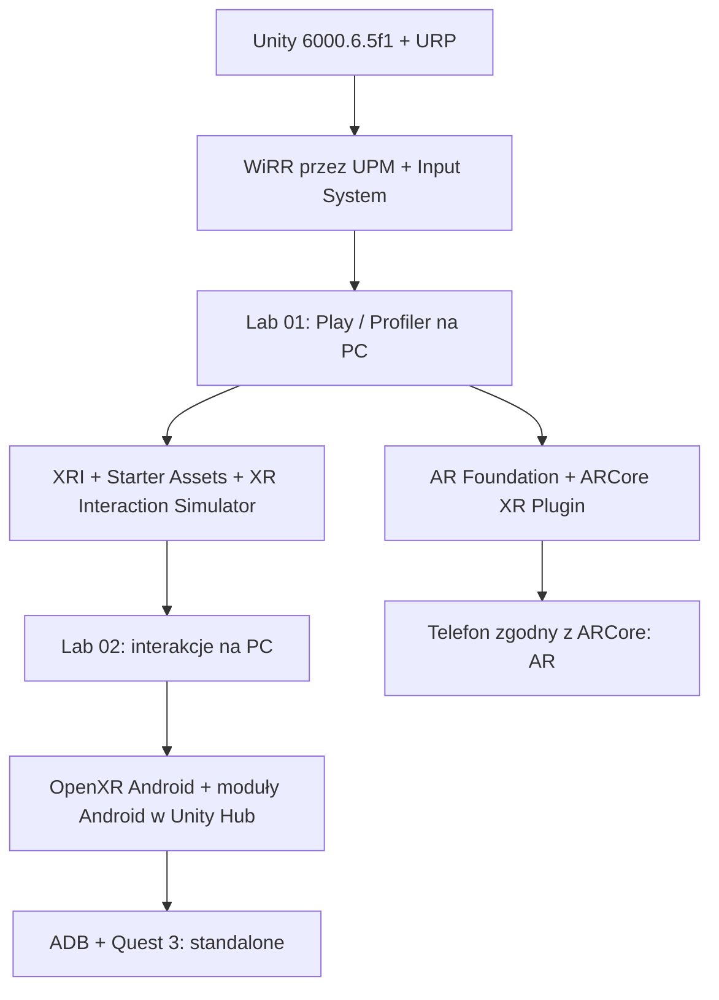

# Unity na Windows i Ubuntu: instrukcja warunkowa

## Spis treści
- [Wybierz aktualną sytuację](#wybierz-aktualną-sytuację)
- [Unity nie jest zainstalowane](#unity-nie-jest-zainstalowane)
- [Windows](#windows)
- [Ubuntu](#ubuntu)
- [Pakiety XR tylko gdy potrzebne](#pakiety-xr-tylko-gdy-potrzebne)
- [Graf ścieżek uruchamiania](#graf-ścieżek-uruchamiania)
- [Urządzenia XR](#urządzenia-xr)
- [Najczęstsze błędy](#najczęstsze-błędy)

## Wybierz aktualną sytuację

| Jeżeli... | Idź do... |
|---|---|
| Nie masz Unity Hub ani edytora | [Unity nie jest zainstalowane](#unity-nie-jest-zainstalowane) |
| Masz Unity, ale nie masz licencji lub konta | [Konto Unity i licencje](UNITY_ACCESS_AND_LICENSES.md#wybierz-jedną-z-trzech-ścieżek) |
| Unity już działa | [Pierwsze 10 minut Lab 01](../../Samples~/Lab01/README.md#1-uruchom-scenę-i-pomiar-30) |
| Pracujesz na Windows | [Windows](#windows) |
| Pracujesz na Ubuntu | [Ubuntu](#ubuntu) |
| Potrzebujesz XRI, ARCore albo OpenXR | [Pakiety XR](#pakiety-xr-tylko-gdy-potrzebne) |
| Telefon lub gogle nie są wykrywane | [Urządzenia XR](#urządzenia-xr) |

## Unity nie jest zainstalowane

1. Sprawdź, czy na uczelnianym stanowisku dostępny jest już gotowy projekt i aktywowana licencja. Nie instaluj kolejnego edytora bez potrzeby.
2. Pobierz Unity Hub z oficjalnej strony https://unity.com/download i wybierz sposób instalacji odpowiedni dla [Windows](#windows) albo [Ubuntu](#ubuntu).
3. Na własnym komputerze użyj własnego Unity ID z bezpłatnym Unity Personal lub opcjonalnie planem Student; procedurę opisuje [instrukcja licencji](UNITY_ACCESS_AND_LICENSES.md). Nie loguj się na wspólne konto prowadzącego.
4. W Unity Hub → Installs → Install Editor wybierz wersję Unity 6000.6.5f1 wskazaną przez prowadzącego. Utwórz projekt Universal 3D (URP).
5. Nie instaluj na razie ROS 2, ARCore, Meta SDK, Dockera ani Android Studio. Wróć do [Lab 01](../../Samples~/Lab01/README.md#1-uruchom-scenę-i-pomiar-30).

## Windows

1. Otwórz Unity Hub i sprawdź, czy wskazana wersja Unity jest już na liście Installs.
2. Otwórz projekt URP. Gdy menedżer pakietów nie importuje paczki WiRR przez Git, sprawdź w PowerShell polecenie **git --version** i pierwszy błąd w Unity Console.
3. Przy budowie APK na Quest lub telefon dopiero teraz doinstaluj w Unity Hub moduły Android Build Support, Android SDK & NDK Tools i OpenJDK.
4. W Unity wybierz File → Build Profiles → Android. Po podłączeniu telefonu/kabla DATA sprawdź **adb devices -l** i zatwierdź pozwolenie debugowania na urządzeniu.
5. Meta Quest Link w Windows jest osobnym wariantem PC VR; do samodzielnej aplikacji Quest użyj wersji Android.

Jeśli wszystko działa, przejdź bezpośrednio do [pierwszego doświadczenia](../../Samples~/Lab01/README.md#1-uruchom-scenę-i-pomiar-30).

## Ubuntu

1. Sprawdź architekturę poleceniem **uname -m** oraz wersję Ubuntu. Zweryfikuj [wymagania Unity 6](https://docs.unity3d.com/6000.0/Documentation/Manual/system-requirements.html).
2. Zainstaluj Unity Hub zgodnie z [oficjalną instrukcją Linux](https://docs.unity3d.com/hub/manual/InstallHub.html) właściwą dla dystrybucji. Nie kopiuj przypadkowych skryptów z Internetu.
3. W Unity Hub zainstaluj zatwierdzony edytor 6000.6.5f1 i projekt URP. Jeśli instalacja paczki Git się nie powiedzie, sprawdź **git --version**.
4. Do Lab 01 i zwykłej sceny PC to wszystko. **Nie wymaga się Meta Quest Link dla Windows na Ubuntu.**
5. Do aplikacji Android dodaj w Hub Android Build Support + SDK/NDK/OpenJDK. W Edit → Preferences → External Tools sprawdź ścieżki.
6. Przy podłączaniu urządzenia sprawdź **lsusb** i **adb devices -l**. Przy unauthorized zatwierdź żądanie na telefonie lub w goglach, przy no permissions zweryfikuj reguły udev swojej dystrybucji. Nie uruchamiaj Unity jako root.
7. ROS 2 i Gazebo mogą działać na przygotowanym stanowisku prowadzącego; student nie musi instalować ich lokalnie, jeśli analizuje dostarczony log.

Jeśli wszystko działa, przejdź do [Lab 01](../../Samples~/Lab01/README.md#1-uruchom-scenę-i-pomiar-30).

## Pakiety XR tylko gdy potrzebne

| Eksperyment | Dodatki |
|---|---|
| Scena URP, skala, fizyka, Profiler | Bez nowych pakietów |
| Chwyt i teleportacja (Lab 02) | XR Interaction Toolkit + wymagane próbki |
| Quest standalone | Android Build Support i provider OpenXR |
| Telefon AR (Lab 03–04) | AR Foundation, provider ARCore i kompatybilny telefon |
| VITURE | Kabel obsługujący wideo i właściwy tryb SBS |
| ROS 2 (Lab 06) | Przygotowany endpoint ROS albo log JointState |

## Graf ścieżek uruchamiania

To graf **kolejności wdrażania**, nie diagram bezpośrednich zależności pakietów. Sprawdź najpierw ścieżkę PC, a dopiero później instaluj komponenty sprzętowe. [Instrukcja pierwszego laboratorium](../../Samples~/Lab01/README.md#1-uruchom-scenę-i-pomiar-30) zawiera tabelę objawów i minimalne wymagania.

## Urządzenia XR

**Przejdź do [procedury sprzętowej Quest 3, Android AR i VITURE Luma Ultra](DEVICE_DEPLOYMENT_QUEST_ANDROID_VITURE.md)**, jeżeli chcesz rzeczywiście podłączyć urządzenie, utworzyć plik APK, zainstalować aplikację lub rozpoznać błędny tor wideo. Wskazówki poniżej są tylko krótką diagnostyką. Przygotowanie wykonuje prowadzący; studentom nie należy przypisywać instalacji sterowników i SDK jako obowiązkowego zadania.

**Quest 3:** gogle mają przycisk zasilania i złącze USB-C. Włącz tryb deweloperski na autoryzowanym koncie, podłącz przewód USB-C DATA i zaakceptuj żądanie na urządzeniu. Sprawdź **adb devices -l**.

**Telefon:** sprawdź kompatybilność [ARCore](https://developers.google.com/ar/devices), włącz debugowanie USB i zaakceptuj autoryzację na ekranie. Brak obsługi Depth API nie oznacza braku ARCore.

**VITURE Luma Ultra:** sprawdź obraz 2D na pełnym porcie USB-C z **DisplayPort Alt Mode**, a dla SpaceWalker dodatkowo transmisję danych USB. W Ubuntu użyj Settings → Displays, w Windows Ustawienia ekranu. **Luma Ultra ma 1920×1200 na oko**, więc nie należy przedstawiać przykładu WiRR 3840×1080 jako trybu natywnego 1200p. Pełna instrukcja: [Luma Ultra](DEVICE_DEPLOYMENT_QUEST_ANDROID_VITURE.md#3-viture-xr-luma-ultra-fizyczne-podłączenie-2d-full-sbs-i-spacewalker).

**ROS 2:** sprawdź **ros2 topic list**, a potem **ros2 topic echo /joint_states --once**, zanim diagnozujesz scenę Unity.

## Najczęstsze błędy

| Objaw | Najpierw sprawdź |
|---|---|
| Unity Hub wymaga zalogowania/aktywacji | [Licencja i Unity ID](UNITY_ACCESS_AND_LICENSES.md) |
| Nie udaje się zaimportować WiRR | Git, wersja edytora, pierwszy błąd Console |
| ADB: unauthorized | Autoryzacja RSA na urządzeniu |
| ADB: no permissions na Ubuntu | Reguły udev, nie uruchamiaj Unity jako root |
| VITURE: czarny ekran | DP Alt Mode, kabel DATA/wideo, adapter i wykrycie drugiego ekranu |
| ROS: brak danych | Endpoint, temat, połączenie, mapowanie przegubów |

Zawsze znajdź **pierwsze niesprawne ogniwo** łańcucha sprzęt → system → uprawnienia → runtime → aplikacja.
