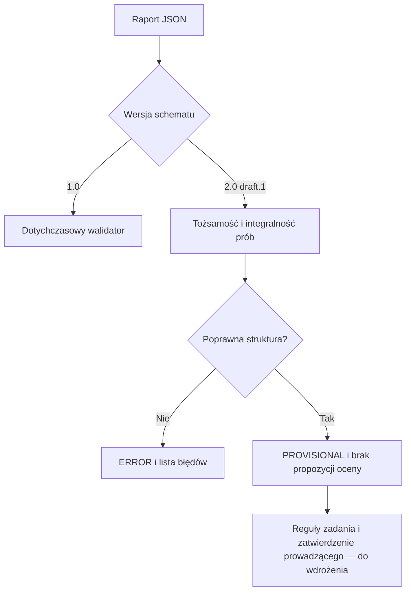

# WiRR 2.0 — kontrakt integralności dowodów (draft.1)

Status: etap integracji, 2026-10-15. Nie jest to działający eksport z nowych scen
ani zatwierdzony grader ocen. Dotychczasowa ścieżka `wirr-report/1.0` pozostaje
obsługiwana przez ten sam `scripts~/wirr_grade_report.py`.

Nową ścieżkę uruchamia wyłącznie jawne `schemaVersion: wirr-report/2.0-draft.1`.
Nie konwertujemy automatycznie dawnych pól `cp30.*` na dowody WiRR 2.0.
Podstawa wymagań: roboczy projekt progów v0.1 oraz nowych instrukcji WiRR 2.0.
Obowiązują materiały zatwierdzone i udostępnione przez prowadzącego.
Nie kopiujemy opisów 40 kryteriów do niezależnej rubryki.



## Pola raportu

| Pole | Wymaganie |
|---|---|
| `submissionId`, `teamId` | Niepuste identyfikatory tekstowe |
| `studentIndices` | Lista 1–2 różnych tekstów, każdy 5–12 cyfr |
| `labNumber` | Liczba całkowita 1–8; każda praca ma osobny raport |
| `createdAtUtc` | Czas ISO 8601 z `Z` lub przesunięciem `+00:00` |
| `versions` | Niepuste `unity`, `package`, `experiment` |
| `activityTimeline`, `activitySummary` | Timeline i podsumowanie jak w 1.0; czasy UTC, skończone nieujemne długości |
| `trials` | Lista prób, również pusta przy przerwanej sesji |
| `checkpointEvidence` | Obiekt o opcjonalnych kluczach `3.0`, `3.5`, `4.0`, `4.5`, `5.0`; wpis zawiera `trial_ids` |
| `conclusion` | Wspólny wniosek; obecność wymagana strukturalnie od 4.0, treść ocenia prowadzący |

## Pola próby

| Pole | Wymaganie |
|---|---|
| `trial_id` | Niepusty tekst, unikalny w raporcie |
| `condition` | Niepusty obiekt nazwanych warunków tekstowych, np. `{"objects": "100", "shadows": "off"}` |
| `timestampUtc` | Czas UTC z jawną strefą |
| `device_mode` | `DESKTOP_SIM`, `SIM_AR`, `REAL_AR`, `ROS_REPLAY`, `ROS_LIVE` |
| `participant_mode` | `SOLO`, `HUMAN`, `GUEST_SIM`; tryb gościa nie zmienia źródła pomiaru |
| `validity` | `VALID`, `FAILED`, `UNAVAILABLE`; dwa ostatnie wymagają tekstowego `reason` |
| `metrics` | Niepusty obiekt nazwanych metryk: `value`, `unit`, opcjonalne `unavailable_reason` |

`value` jest skończoną liczbą albo jawnym `null`. Zero pozostaje zerem; bool,
tekst liczbowy, NaN i nieskończoność nie są pomiarami. `null` wymaga powodu
niedostępności. Próba `VALID` wymaga co najmniej jednej zmierzonej metryki;
metryki opcjonalne mogą pozostać niedostępne. Jednostki nie są jeszcze
normalizowane ani weryfikowane względem zadania — obecność `ms` nie dowodzi,
że pomiar ma właściwy sens fizyczny.

Odwołania checkpointu muszą być unikalne, wskazywać poprawne próby `VALID`
i pochodzić z jednego `device_mode`. Nie porównujemy REAL z SIM ani LIVE
z REPLAY jako tego samego eksperymentu. Nieudane próby pozostają w raporcie,
ale nie uzupełniają checkpointu. Kolejność jest kumulatywna; brak 3.0 blokuje
strukturę kolejnych progów. Raport Lab01 nie odblokowuje ani nie blokuje Lab02.

## Wynik i dalsze bramki

- `status=PROVISIONAL` oznacza wyłącznie brak błędów struktury; błędy dają `ERROR`.
- `structurally_complete_checkpoints` opisuje tylko obecność poprawnych odwołań
  i wniosku; nawet jedna próba przypisana do pięciu progów nie dowodzi ich wykonania.
- `proposed_grade=null`, `achieved_checkpoints=[]` i
  `requiresInstructorApproval=true` obowiązują zawsze w tym etapie.
- `missing_evidence` zawiera brakujące odwołania oraz stałą bramkę brakujących,
  zatwierdzonych reguł zadania. Wniosek nie jest oceniany automatycznie.

Do następnego etapu pozostają: reguły kryteriów wszystkich 8 laboratoriów
z jednym wersjonowanym źródłem rubryki, porównywalność A/B (w tym jednostki),
pomiar w scenach, zapis/odtwarzanie prób i połączenie dwóch raportów w sesję
bloku. Ten kontrakt nie deklaruje stanu `SENT`, potwierdzenia serwera,
autentyczności pomiarów ani odporności zapisu Unity na restart.

## Uruchomienie bez sieci

```sh
python scripts~/wirr_grade_report.py report.json --output grading-result.json
python -m unittest discover -s scripts~ -p 'test_wirr*.py' -v
```

Kod wyjścia: `0` — integralność poprawna (nie oznacza oceny ani wysłania),
`1` — błędy integralności, `2` — błąd odczytu/pliku JSON.
Testy używają danych syntetycznych: 40 kombinacji lab/próg, puste sesje,
solo/pary/gość, braki/zera, niepoprawne liczby, źródła i odwołania oraz CLI
z lokalnym eksportem. Nie są testem PlayMode ani odbiorem Ubuntu/Windows.
Nie zmieniamy workflow i nie uruchamiamy Actions z gałęzi roboczej.
